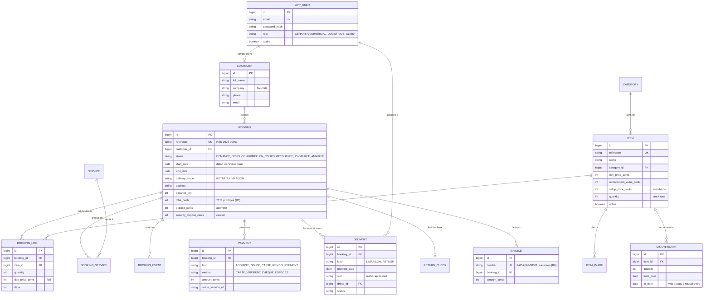

# Modèle de données

Montants en **centimes d'euro** (R5). Les tables sont créées par des migrations Flyway versionnées.



## Calcul de la disponibilité (R1)

Pour un article et une période `[début, fin]`, la période **bloquée** d'une réservation va de la veille de son début au
lendemain de sa fin (préparation et nettoyage). Disponible =

```
stock de l'article
 − quantités réservées par les réservations CONFIRMEE ou EN_COURS dont la période bloquée chevauche [début, fin]
 − quantités en réparation sur [début, fin]
```

Deux périodes `[a, b]` et `[c, d]` se chevauchent quand `a ≤ d` et `c ≤ b`. Au moment de confirmer une réservation, les articles
concernés sont **verrouillés** (`SELECT … FOR UPDATE`) puis la disponibilité est recalculée (R2).
